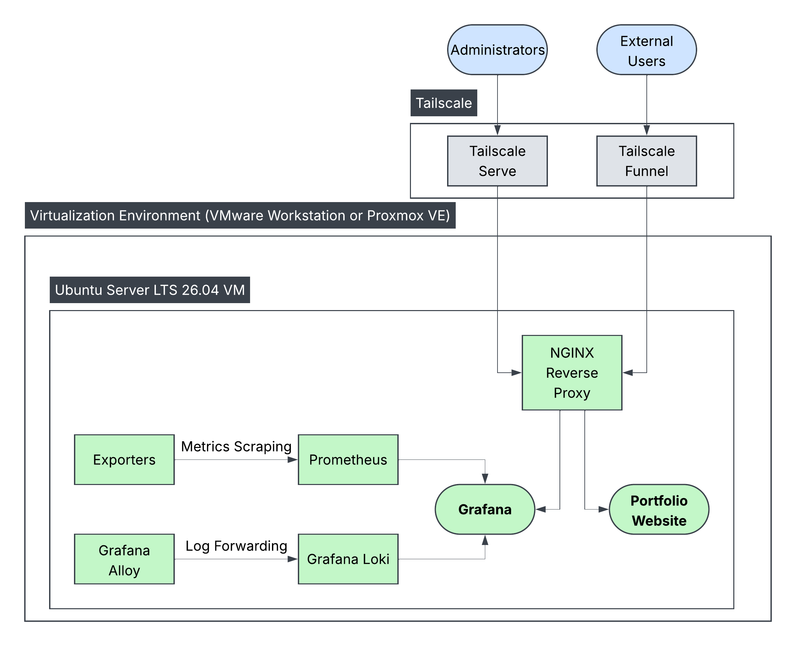

In DevOps, monitoring is a vital skill for maintaining application reliability and performance. Prometheus and Grafana are two popular open-source tools for building a robust monitoring system. 

The system uses an integrated monitoring stack consisting of Grafana, Prometheus, Loki, Grafana Alloy, Node Exporter, and additional exporters and scrapers to collect, process, store, and visualize infrastructure metrics and logs.

---
## System Architecture and Diagram

The Homelab Monitoring System follows a centralized, single-VM deployment architecture hosted on a virtualization platform. The infrastructure currently runs on VMware Workstation Pro, with an equivalent replica available on Proxmox VE.

A single Ubuntu Server 26.04 virtual machine hosts all monitoring and web services, including Grafana, Prometheus, Loki, Grafana Alloy, Nginx, and the required exporters and scrapers.

Prometheus collects infrastructure metrics through exporters, while Grafana Alloy handles log collection and forwarding to Loki. Grafana serves as the centralized visualization platform, integrating Prometheus and Loki as its data sources.

Nginx acts as the reverse proxy for web traffic, while Tailscale provides remote connectivity through Serve for private services and Funnel for public portfolio access.

The architecture is designed to provide centralized infrastructure observability while maintaining deployment portability between Proxmox VE and VMware Workstation Pro.

### Core Components:

- **Virtualization Infrastructure:** Proxmox VE provides the final production environment, while VMware Workstation Pro serves as the testing and development platform.
- **Operating System:** Ubuntu Server 26.04 hosts all monitoring and web services.
- **Metrics Collection:** Prometheus scrapes Node Exporter and other exporter endpoints to collect infrastructure performance metrics.
- **Log Collection:** Grafana Alloy collects system and application logs and forwards them to Loki.
- **Log Aggregation:** Loki centralizes and stores collected log data.
- **Visualization:** Grafana provides centralized dashboards and integrates Prometheus and Loki as data sources.
- **Web Services:** Nginx handles incoming web traffic and routes requests to the appropriate services.
- **Remote Access:** Tailscale Serve provides private access to internal monitoring services, while Tailscale Funnel exposes the public portfolio website.
---
## Documentation and Resources

Additional documentation is maintained separately to keep installation procedures, configuration instructions, and technical notes organized and easy to maintain.

| Documentation                                  | Description                                                                  |
| ---------------------------------------------- | ---------------------------------------------------------------------------- |
| [Installation Guide](notes/00-installation.md) | Step-by-step instructions for installing and deploying the monitoring stack. |
| [Set up Errors](notes/01-setup-errors.md)      | Technical notes, troubleshooting procedures, and known issues.               |
| [Notes](notes/concepts-learned.md)             | Concepts and additional notes                                                |

Refer to these documents for detailed setup instructions, troubleshooting examples, and additional technical information.

---
## Monitoring and Data Flow

Prometheus collects metrics from available exporters, while Grafana Alloy gathers and forwards logs to the centralized Loki instance.

Grafana connects to Prometheus and Loki, allowing infrastructure metrics and logs to be visualized and analyzed through centralized dashboards.

Nginx handles incoming web requests and routes traffic to the appropriate backend services. Public portfolio access is provided through Tailscale Funnel, while internal monitoring access is restricted to private connectivity through Tailscale Serve.

---
## Deployment Strategy

The monitoring environment is initially developed and tested using VMware Workstation Pro. Configurations, services, and system behavior are validated before being migrated to the final Proxmox VE environment.

The production deployment uses a single Ubuntu Server 26.04 virtual machine with local VM storage for monitoring metrics, logs, and application data.

---
## Security and Networking

Tailscale provides secure remote connectivity to the homelab environment. Tailscale Funnel enables public access to the portfolio website, while Tailscale Serve provides private access to monitoring services.

Nginx acts as the reverse proxy for incoming web traffic, routing requests to their respective backend services.

---
## System Objectives

- Centralize infrastructure monitoring and observability.
- Monitor system resource utilization and service availability.
- Aggregate system and application logs.
- Visualize infrastructure metrics and logs using Grafana.
- Monitor public portfolio accessibility and web traffic.
- Provide secure remote access to internal monitoring services.
- Validate deployments in VMware before production migration to Proxmox VE.
---
## Limitations and Known Constraints

The current implementation has several infrastructure and operational limitations due to hardware availability and the centralized deployment design.

- **Single Point of Failure:** All monitoring and web services operate within a single virtual machine. VM downtime may result in simultaneous loss of monitoring, log aggregation, dashboards, and hosted web services.
- **Resource Constraints:** The monitoring stack shares the available CPU, memory, and storage resources of a single host, potentially affecting performance as the number of monitored services and collected telemetry increases.
- **Local Storage Dependency:** Prometheus metrics, Loki logs, and application data are stored on local VM storage. Storage failure or insufficient capacity may result in data loss or service disruption.
- **Limited High Availability:** The current architecture does not implement redundant monitoring instances, automated failover, or load balancing.
- **Testing and Production Differences:** VMware Workstation Pro is used for development and testing, while Proxmox VE is the intended production environment. Differences in virtualization, networking, and resource allocation may require configuration adjustments during migration.
- **Monitoring Coverage:** Infrastructure visibility depends on the availability and proper configuration of exporters, scrapers, and log collectors. Services without configured telemetry endpoints may not be fully monitored.
- **Network Dependency:** Remote access and public portfolio availability depend on network connectivity and the availability of the configured Tailscale and Nginx services.
---
### Future Improvements

The following enhancements may be considered as the infrastructure evolves:

- Distribute monitoring services across multiple virtual machines.
- Implement automated backups and disaster recovery procedures.
- Introduce dedicated or network-attached storage for monitoring data.
- Configure Grafana Alerting or Prometheus Alertmanager for proactive notifications.
- Expand monitoring coverage to include Proxmox host metrics, VM health, network traffic, and application performance.
- Implement infrastructure automation using Ansible.
- Evaluate containerization and service orchestration as hardware resources become available.