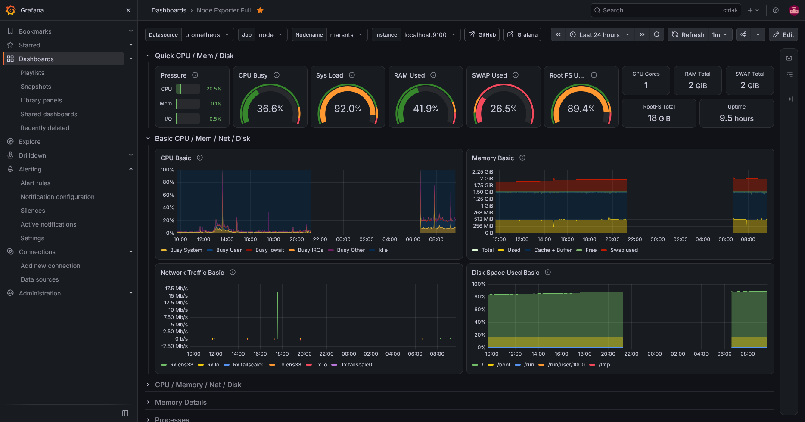

### Prerequisites

I currently have a [homelab](https://github.com/marsnts/homelab) configurated in my machine. This includes installation of VMs and setting up nginx and Tailscale.

### 00 Exporters Setup
Use the following exporters for different metrics. Refer to [concepts-learned](notes/concepts-learned.md) for exporters notes.

In this project, any exporter can be installed. The process is similar if adding other exporters.
- Download Node and Nginx exporters:
```bash
# Node Exporter
wget "https://github.com/prometheus/node_exporter/releases/download/v1.12.1/node_exporter-1.12.1.linux-amd64.tar.gz"

# Nginx Exporter
wget "https://github.com/nginx/nginx-prometheus-exporter/releases/download/v1.5.3/nginx-prometheus-exporter_1.5.3_linux_amd64.tar.gz"
```

- Extract these exporter packages
```bash
sudo tar -xzvf "node_exporter-1.12.1.linux-amd64.tar.gz"
sudo tar -xzvf "nginx-prometheus-exporter_1.5.3_linux_amd64.tar.gz"
```

- Move Exporters to `/usr/local/bin`

```bash
sudo mv "node_exporter-1.12.1.linux-amd64.tar.gz" /usr/local/bin
sudo mv "nginx-prometheus-exporter_1.5.3_linux_amd64.tar.gz" /usr/local/bin
```

- Clean extracted files
```bash
rm -r "node_exporter-1.12.1.linux-amd64.tar.gz"
rm -r "nginx-prometheus-exporter_1.5.3_linux_amd64.tar.gz"
```

#### 00.01 Node Exporter Setup
- Create node exporter user:
```bash
sudo useradd -rs /bin/false node_exporter
```

- Create systemd service for node exporter:
```bash
cat <<EOL | sudo tee /etc/systemd/system/node_exporter.service> /dev/null

[Unit]
Description= Node Exporter
Wants=network-online.target
After=network-online.target

[Service]
User=node_exporter
Group=node_exporter
Type=simple
Restart=on-failure
RestartSec=5s
ExecStart=/usr/local/bin/node_exporter

[Install]
WantedBy=multi-user.target
EOL
```

- Reload systemd daemon:
```bash
sudo systemctl daemon-reload
```

- Enable and start NGINX-Prometheus exporter as a service
```bash
sudo systemctl enable node_exporter
sudo systemctl start node_exporter
```

- Check Node Exporter Status:
```bash
sudo systemctl status node_exporter
```

##### 00.02 Nginx Exporter Setup

- Create systemd service for node exporter:
```bash
cat <<EOL | sudo tee /etc/systemd/system/nginx-prometheus-exporter.service> /dev/null

[Unit]
Description= NGINX Prometheus Exporter
After=network.target

[Service]
User=nobody
ExecStart=/usr/local/bin/nginx-prometheus-exporter -nginx.scrape-uri=http://127.0.0.1:80/status
Restart=always

[Install]
WantedBy=multi-user.target
EOL
```

- Reload systemd daemon:
```bash
sudo systemctl daemon-reload
```

- Enable and start node exporter as a service
```bash
sudo systemctl enable nginx-prometheus-exporter
sudo systemctl start nginx-prometheus-exporter
```

- Check NGINX-Prometheus Exporter Status:
```bash
sudo systemctl status nginx-prometheus-exporter
```

- Edit server block on NGINX config:
```nginx
server {
   listen 127.0.0.1:8080;
   server_name localhost;
   
   location /status {
      stub_status on;
      access_log off;
      allow 127.0.0.1;
      deny all;   
   }
}
```
> Note that this is a basic server block. Refer below to **07 Additional Configuration** for further information.
### 01 Install Prometheus
```bash
wget https://github.com/prometheus/prometheus/releases/download/v3.13.5/prometheus-3.13.5.linux-amd64.tar.gz
```

- Extract and move files:
```bash
tar -xvvf prometheus-3.13.5.linux-amd64.tar.gz    
cd prometheus-3.13.5.linux-amd64    
sudo mv prometheus /usr/local/bin/    
sudo mv promtool /usr/local/bin/
```

- Create configuration file:
Edit `prometheus.yml` to define scrape targets using `sudo nano prometheus.yml`
```yml
scrape_configs:
  - job_name: 'node'
    static_configs:
      - targets: ['<node_exporter_ip>:9100']

  - job_name: 'mysql'
    static_configs:
      - targets: ['<mysql_exporter_ip>:9104']

  - job_name: 'mongodb'
    static_configs:
      - targets: ['<mongodb_exporter_ip>:9216']

  - job_name: 'nginx'
    static_configs:
      - targets: ['<nginx_exporter_ip>:9113']
``` 

- Run Prometheus:
```bash
prometheus --config.file=prometheus.yml
```

- Visit`http://localhost:9090`to verify if Prometheus is running or:
```bash
curl -I localhost:9090
```

##### Running Prometheus in the background

- Create a systemd service file for prometheus
```bash
sudo nano /etc/systemd/system/prometheus.service
```

- Edit the service configuration file:
```ini
[Unit]
Description=Prometheus
Wants=network-online.target
After=network-online.target

[Service]
User=root
Type=simple
WorkingDirectory=/var/git/projects/monitoring-system
ExecStart=/usr/local/bin/prometheus --config.file=/var/git/projects/monitoring-system/prometheus.yml --storage.tsdb.path=/var/git/projects/monitoring-system/data
Restart=always

[Install]
WantedBy=multi-user.target
```
Always make sure that the Prometheus binary file is located on the path and change the `WorkingDirectory` to the proper working directory.

- Start and enable the service
```bash
sudo systemctl daemon-reload
sudo systemctl enable prometheus
sudo systemctl start prometheus
```

- Verify if Prometheus service is running:
```bash
sudo systemctl status prometheus
# and
curl -I localhost:9090
```

###### Routing the Dashboard through Tailscale Tailnet and Nginx

- Configure Prometheus to listen locally by updating the prometheus service config file:
```bash
sudo nano /etc/systemd/system/prometheus
```
- Edit the `ExecStart`:
```ini
ExecStart=/usr/local/bin/prometheus --config.file=/var/git/projects/monitoring-system/prometheus.yml --storage.tsdb.path=/var/git/projects/monitoring-system/data --web.listen-address=127.0.0.1:9090
```
- Apply changes and restart prometheus:
```bash
sudo systemctl daemon-reload
sudo systemctl restart prometheus
```

### 02 Install Grafana

```bash
sudo apt-get install -y software-properties-common    
sudo add-apt-repository "deb https://packages.grafana.com/oss/deb stable main"    
sudo apt-get update    
sudo apt-get install grafana
```

- Install the prerequisite packages:
```bash
sudo apt-get install -y apt-transport-https wget gnupg
```

- Import GPG key:
```bash
sudo mkdir -p /etc/apt/keyrings
sudo wget -O /etc/apt/keyrings/grafana.asc https://apt.grafana.com/gpg-full.key
sudo chmod 644 /etc/apt/keyrings/grafana.asc
```

- Add repository for stable releases:
```bash
echo "deb [signed-by=/etc/apt/keyrings/grafana.asc] https://apt.grafana.com stable main" | sudo tee -a /etc/apt/sources.list.d/grafana.list
```

- Update the list of available packages:
```bash
sudo apt-get update
```

- Install Grafana OSS (Open Source): 
```bash
sudo apt-get install grafana
```

- Start Grafana:
```bash
sudo systemctl start grafana-server
sudo systemctl enable grafana-server
```

- Visit `http://localhost:3000` login with the default credentials `admin / admin`

##### Running Grafana in the background

- Create a systemd service file for grafana
```bash
sudo nano /etc/systemd/system/grafana-server.service
```

- Edit the service configuration file:
```ini
[Unit]
Description=Grafana Server
After=network.target

[Service]
Type=simple
User=grafana
Group=users
ExecStart=/usr/local/grafana/bin/grafana server --config=/usr/local/grafana/conf/grafana.ini --homepath=/usr/local/grafana
Restart=on-failure

[Install]
WantedBy=multi-user.target
```
Always make sure that the grafana binary file is located on the path and change the `WorkingDirectory` to the proper working directory.

- Start and enable the service
```bash
sudo systemctl daemon-reload
sudo systemctl enable grafana
sudo systemctl start grafana
```

- Verify if Prometheus service is running:
```bash
sudo systemctl status grafana
# and
curl -I localhost:3000
```

##### Fix Grafana `root_url` Hardcoding

Hardcode explicit URL in `/etc/grafana/grafana.ini` file and modify the following:
```ini
[server]
protocol = http
http_addr = 127.0.0.1
http_port = 3000

# Explicitly hardcode your Tailscale URL and port here:
root_url = https://marsnts.tarsier-map.ts.net:8443/grafana/

# Force Grafana to expect the prefix locally
serve_from_sub_path = true
```

### 03 Connect Prometheus as Data Source

In Grafana, navigate to Connections > Data Sources > Add Data Source > Prometheus

- Enter `http://localhost:9090` or `https://marsnts.tarsier-map.ts.net:8443/prometheus/query` as the URL and save the configuration.

Verify the connection by creating a new dashboard and add a panel to visualize metrics from Prometheus

### 04 Visualizing Metrics with Dashboards

In Grafana, go to Dashboards > New Dashboard > Add New Panel

Select a metric from Prometheus and customize the graph as needed. Do not forget to save the dashboard.

There are a library of pre-built dashboards in Grafana. Navigate to Dashboards > Import, and enter the dashboard ID form the Grafana Dashboard Repository.

Dashboard IDs:
Nginx = 14900
Node = 1860
Loki = 13865 , 16101
Loki NGINX Dashboard = 24306

#### Sample Grafana Dashboard



### 05 Set Up Alerts

Edit `prometheus.yml`:
```yml
groups:  
  - name: example_alert  
    rules:  
      - alert: HighCPUUsage  
        expr: node_cpu_seconds_total > 80  
        for: 2m  
        labels:  
          severity: critical  
        annotations:  
          summary: "High CPU usage detected!"
```

Go to Grafana > Alerting > Notification Channels. Configure email, Slack, or webhook notifications.

### 06 Monitoring

Use the dashboard to analyze real-time metrics.
Set alerts for critical issues.
Continuously improve dashboard

### 07 Grafana Loki (WIP)

Grafana Loki is a log aggregation system designed to store and query logs from all your applications and infrastructure.

Grafana Loki will allow log data scraped by Promtail to be stored and send to Grafana to view the metrics. 

`[ Nginx Access Log ] ──(reads file)──> [ Alloy ] ──(pushes via HTTP)──> [ Grafana Loki ] ──> [ Grafana UI ]`

> Note that my goal is to view who visit my portfolio and will not use any information or data gathered for any other use. I wanted to do this just to know how many individuals visit my portfolio and also to learn more about these technologies.

- Install and Configure Loki:
```bash
sudo apt-get install loki
```
This will install the latest version of Grafana Loki (3.7.9).
- Verify if Loki is running:
```bash
sudo systemctl status loki
```
- Create or edit loki systemd service file using `sudo nano /etc/systemd/sytstem/loki.service`:
```ini
[Unit]
Description=Loki Service
After=network.target

[Service]
User=loki
ExecStart=/usr/bin/loki -config.file=/etc/loki/config.yaml
Restart=on-failure

[Install]
WantedBy=multi-user.target
```
- Start and enable loki:
```bash
sudo systemctl daemon-reload
sudo systemctl enable --now loki
```

- Install and Configure Grafana Alloy
If the system does not have GPG installed, install first GPG in the system using:
```bash
sudo apt install gpg
```
- Set up GPG key (if not yet imported during Grafana installation earlier)
```bash
sudo mkdir -p /etc/apt/keyrings
sudo wget -O /etc/apt/keyrings/grafana.asc https://apt.grafana.com/gpg-full.key
sudo chmod 644 /etc/apt/keyrings/grafana.asc
echo "deb [signed-by=/etc/apt/keyrings/grafana.asc] https://apt.grafana.com stable main" | sudo tee /etc/apt/sources.list.d/grafana.list
```
- Update repository and install Alloy:
```bash
sudo apt-get update
sudo apt-get install alloy
```
- Start Alloy:
```bash
sudo systemctl start alloy
```
- Verify if Alloy is running:
```bash
sudo systemctl status alloy
```
- Configure Alloy to start as a service when system starts:
```bash
sudo systemctl enable alloy.service
```
- Ensure that Alloy can read nginx logs:
```bash
sudo usermod -aG adm alloy
sudo systemctl restart alloy
```
- Edit `config.alloy` at `/etc/alloy/`
```ini
// 1. Discover the Nginx log files
local.file_match "nginx_logs" {
  path_targets = [
    { __path__ = "/var/log/nginx/access.log", job = "nginx", log_type = "access" },
    { __path__ = "/var/log/nginx/error.log",  job = "nginx", log_type = "error" },
  ]
}

// 2. Scrape the matched files and forward them
loki.source.file "nginx" {
  targets    = local.file_match.nginx_logs.targets
  forward_to = [loki.write.loki_endpoint.receiver]
}

// 3. Define the Loki endpoint destination
loki.write "loki_endpoint" {
  endpoint {
    url = "http://localhost:3100/loki/api/v1/push"
    
    // Uncomment and fill if your Loki instance requires Authentication
    // basic_auth {
    //   username = "your_username"
    //   password = "your_password"
    // }
  }
}
```
- Validate and Apply Configuration
```bash
sudo alloy validate /etc/alloy/config.alloy
```
- Restart and verify if Alloy is properly running:
```bash
sudo systemctl restart alloy
sudo systemctl status alloy
```
##### Configuring Nginx

- Configure Nginx log format on `/etc/nginx/nginx.conf`:
```nginx
http {
    log_format json_analytics escape=json '{'
        '"time_local":"$time_local",'
        '"remote_addr":"$remote_addr",'
        '"request_method":"$request_method",'
        '"request_uri":"$request_uri",'
        '"status": "$status",'
        '"body_bytes_sent":"$body_bytes_sent",'
        '"request_time":"$request_time",'
        '"http_referrer":"$http_referer",'
        '"http_user_agent":"$http_user_agent"'
    '}';

    # Tell NGINX to use this new format for access logs
    access_log /var/log/nginx/access.log json_analytics;
}
```
This defines a custom log format named `json_analytics`. It includes timestamp, IP address, request line, HTTP status code, response size, referrer, and user agent. `access_log` tells NGINX to write access logs to `/var/log/nginx/access.log` using the `json_analytics` format defined.
- Test and reload nginx:
```bash
sudo nginx -t
sudo systemctl reload nginx
```
##### Configuring Loki

- Configure Loki using `sudo nano /etc/loki/config.yml`:
```ini
auth_enabled: false

server:
  http_listen_port: 3100
  grpc_listen_port: 9096
  log_level: debug
  grpc_server_max_concurrent_streams: 1000

common:
  instance_addr: 127.0.0.1
  path_prefix: /tmp/loki
  storage:
    filesystem:
      chunks_directory: /tmp/loki/chunks
      rules_directory: /tmp/loki/rules
  replication_factor: 1
  ring:
    kvstore:
      store: inmemory

query_range:
  results_cache:
    cache:
      embedded_cache:
        enabled: true
        max_size_mb: 100

limits_config:
  metric_aggregation_enabled: true

schema_config:
  configs:
    - from: 2020-10-24
      store: tsdb
      object_store: filesystem
      schema: v13
      index:
        prefix: index_
        period: 24h

pattern_ingester:
  enabled: true
  metric_aggregation:
    loki_address: localhost:3100

ruler:
  alertmanager_url: http://localhost:9093

frontend:
  encoding: protobuf

# By default, Loki will send anonymous, but uniquely-identifiable usage and configuration
# analytics to Grafana Labs. These statistics are sent to https://stats.grafana.org/
#
# Statistics help us better understand how Loki is used, and they show us performance
# levels for most users. This helps us prioritize features and documentation.
# For more information on what's sent, look at
# https://github.com/grafana/loki/blob/main/pkg/analytics/stats.go
# Refer to the buildReport method to see what goes into a report.
#
# If you would like to disable reporting, uncomment the following lines:
#analytics:
#  reporting_enabled: false
```

### 08 Additional Configuration 

Refer to https://github.com/marsnts/homelab. System is running on Tailscale and Nginx. Additional nginx configuration and routing is needed.

Allow port 9090 trough ufw:
```bash
sudo uwf allow 9090/tcp
```

Updating nginx server blocks:
```nginx
# GLOBAL CONTEXT (Must live outside server blocks)
map $http_upgrade $connection_upgrade {
    default upgrade;
    ''      close;
}

# Marsnts Portfolio
server {
    listen 127.0.0.1:8081;
    server_name localhost;

    root /var/www/static-resume;
    index index.html index.htm;


    # Extract true remote visitor IP sent by the Funnel
    real_ip_header X-Forwarded-For;
    real_ip_recursive on;

    # Captures traffic data specifically for this server block
    access_log /var/log/nginx/portfolio.access.log;
    error_log /var/log/nginx/portfolio.error.log;

    # Use JSON format log
    #access_log /var/log/nginx/access_json.log json_analytics;

    location / {
        try_files $uri $uri/ =404;

    }
}

# 3. INTERNAL DASHBOARDS (Listening on local port 8083)
server {
    listen 127.0.0.1:8083;
    server_name localhost;
   
	# Trust the Tailscale IP and local loopback
    set_real_ip_from 100.64.0.0/10;
    set_real_ip_from 127.0.0.1;
    
    # Common proxy headers to keep configs clean
    proxy_set_header Host $host;
    proxy_set_header X-Real-IP $remote_addr;
    proxy_set_header X-Forwarded-For $proxy_add_x_forwarded_for;
    proxy_set_header X-Forwarded-Proto $scheme;

    # Apply WebSocket upgrades globally inside this block
    proxy_http_version 1.1;
    proxy_set_header Upgrade $http_upgrade;
    proxy_set_header Connection $connection_upgrade;
    proxy_read_timeout 1800s;

    # Route A: Grafana Dashboard
    location / {
        #proxy_pass http://127.0.0.1:3000;

        # Common proxy headers to keep configs clean
        proxy_set_header Host $host;
        proxy_set_header X-Real-IP $remote_addr;
        proxy_set_header X-Forwarded-For $proxy_add_x_forwarded_for;
        proxy_set_header X-Forwarded-Proto $scheme;

    }

    # Route B: Loki Dashboard
    location /loki/ {
        proxy_pass http://127.0.0.1:3100/ready;

        # Common proxy headers to keep configs clean
        proxy_set_header Host $host;
        proxy_set_header X-Real-IP $remote_addr;
        proxy_set_header X-Forwarded-For $proxy_add_x_forwarded_for;
        proxy_set_header X-Forwarded-Proto $scheme;
    }

    # Route C: Prometheus Engine UI
    location /prometheus/ {
        proxy_pass http://127.0.0.1:9090;

        # Common proxy headers to keep configs clean
        proxy_set_header Host $host;
        proxy_set_header X-Real-IP $remote_addr;
        proxy_set_header X-Forwarded-For $proxy_add_x_forwarded_for;
        proxy_set_header X-Forwarded-Proto $scheme;
    }

    # Route D: Grafana Alloy
    location /alloy/ {
        proxy_pass http://127.0.0.1:12345;

        # Common proxy headers to keep configs clean
        proxy_set_header Host $host;
        proxy_set_header X-Real-IP $remote_addr;
        proxy_set_header X-Forwarded-For $proxy_add_x_forwarded_for;
        proxy_set_header X-Forwarded-Proto $scheme;
    }

    # Route E: Grafana Dashboard
    location /grafana/ {
       proxy_pass http://127.0.0.1:3000;

       # Common proxy headers to keep configs clean
       proxy_set_header Host $host;
       proxy_set_header X-Real-IP $remote_addr;
       proxy_set_header X-Forwarded-For $proxy_add_x_forwarded_for;
       proxy_set_header X-Forwarded-Proto $scheme;

    }
}

# OPTIONAL: Port 80 Redirect to Secure Port 443
server {
    listen 100.104.219.65:80;
    server_name marsnts.tarsier-map.ts.net;
    return 301 https://$host$request_uri;
}

```

- Update `/etc/grafana/grafana.ini`
```bash
sudo nano /etc/grafana/grafana.ini
```
- Locate the `[server]` block and edit the following:
```ini
protocol = http
http_port = 3000

root_url = https://marsnts.tarsier-map.ts.net:8443/grafana/
serve_from_sub_path = true
```
Note that `;` is a comment tag. Remove leading `;` for the configuration to take effect.

### 09 Dashboard Creation (WIP)


### Environment Quick Reference

| Service                       | Port    | Default Config Path              | Systemd Service Name        |
| :---------------------------- | :------ | :------------------------------- | :-------------------------- |
| **Prometheus**                | `9090`  | `/etc/prometheus/prometheus.yml` | `prometheus.service`        |
| **Grafana**                   | `3000`  | `/etc/grafana/grafana.ini`       | `grafana-server.service`    |
| **Node Exporter**             | `9100`  | *N/A (Flags only)*               | `node_exporter.service`     |
| **NGINX-Prometheus Exporter** |         | *N/A (Flags only)*               | `nginx-prometheus-exporter` |
| **Grafana Loki**              | `9096`  | `/etc/loki/config.yml`           | `loki.service`              |
| **Grafana Alloy**             | `12345` | `/etc/alloy/config.alloy`        | `alloy.service`             |
| **Tailscale Funnel**          | `443`   |                                  | `tailscaled.service`        |
| **Tailscale Serve**           | `8443`  |                                  | `tailscale.service`         |